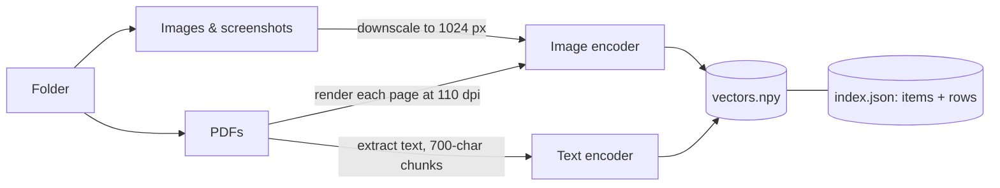
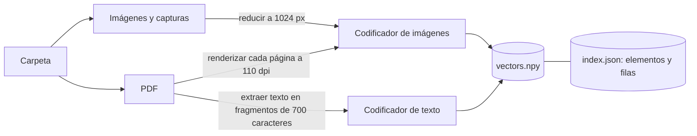

# Guía del repositorio

1. [Instalación y ejecución en este equipo Windows](#1-instalación-y-ejecución-en-este-equipo-windows)
2. [README original en inglés](#2-readme-original-en-inglés)
3. [Traducción del README al español](#3-traducción-del-readme-al-español)

---

# 1. Instalación y ejecución en este equipo Windows

Esta guía recoge los pasos realizados en este ordenador. Debajo se conservan el README original en inglés y su traducción al español.

### 1. Situarse en el proyecto

El fork ya estaba clonado en `C:\Users\cardo\OneDrive\Formacion Compatida\OtrosProyectos\EricBusquedaSemantica`. Desde esa carpeta, en PowerShell, entramos en la carpeta de la aplicación:

```powershell
cd app
```

No fue necesario repetir `git clone`.

### 2. Comprobar Python

```powershell
py -0p
```

El comando mostró Python 3.14. Aunque el autor probó el proyecto con Python 3.11, decidimos probar primero con el 3.14 disponible. Se han instalado las dependencias y cargado el modelo, pero la indexación y la búsqueda aún están pendientes de comprobar.

### 3. Crear el entorno virtual

Desde `app` ejecutamos:

```powershell
py -3.14 -m venv .venv
```

Un entorno virtual es una carpeta con un entorno de Python para el proyecto. Permite instalar sus bibliotecas por separado de las de otros proyectos. Se creó `app\.venv` usando como base el Python 3.14 existente; no se instaló otra versión de Python. Comprobamos que el ejecutable del entorno usa Python 3.14.3.

No es una máquina virtual ni una barrera de seguridad: la aplicación conserva los permisos del usuario que la ejecuta. El entorno está dentro de OneDrive, por lo que podría sincronizarse según su configuración. Git lo ignora mediante la regla `app/.venv/` de `.gitignore`.

No es imprescindible activar el entorno: podemos indicar directamente la ruta a su ejecutable, como en los siguientes pasos.

### 4. Instalar las dependencias

Desde `app` ejecutamos:

```powershell
.\.venv\Scripts\python.exe -m pip install -r requirements.txt
```

`pip` instala en el entorno virtual las bibliotecas enumeradas en `requirements.txt`. La instalación terminó con `Successfully installed`, entre otros, PyTorch 2.15.0, Transformers 5.22.1 y Sentence Transformers 6.2.0. El aviso de que existe una versión más reciente de `pip` no es un error y no fue necesario actualizarlo.

### 5. Arrancar la aplicación

Desde `app` ejecutamos:

```powershell
.\.venv\Scripts\python.exe search.py
```

El programa inicia un servidor local y abre la interfaz, normalmente en `http://127.0.0.1:8765`. Si no se encuentra la ventana, se puede abrir esa dirección en un navegador. Hay que dejar la terminal abierta mientras se utiliza; para detener el servidor se pulsa `Ctrl+C` en ella. Mientras el servidor funciona, esa terminal está ocupada y no sirve para introducir otros comandos.

En el primer arranque, el programa descargó automáticamente el modelo `google/embeddinggemma-2` desde Hugging Face y su estado pasó a **listo**, usando la CPU. No hubo que crear una cuenta ni configurar una clave. Por defecto, el modelo se guarda en `app\.cache-hf\`, también dentro de OneDrive; esa carpeta está excluida de Git, pero podría sincronizarse con OneDrive. El entorno `.venv` y la caché del modelo son carpetas distintas.

Se mostraron avisos sobre el rendimiento de `bfloat16` en CPU y sobre una futura retirada de la decodificación de imágenes con `torchvision`; no impidieron cargar el modelo. La indexación y las búsquedas todavía no se han probado.

### 6. Seleccionar una carpeta e indexar — pendiente

En la interfaz, **Choose folder** permite elegir una carpeta con imágenes y PDF. Después se pulsa **Index** y se espera a que termine; entonces se puede buscar. El índice, las miniaturas y fragmentos de texto se guardan en `app\indexes\`, que está excluida de Git pero también se encuentra en OneDrive.

Para una primera prueba pequeña se puede preparar una carpeta independiente con unos pocos archivos de `demo-folder`. Más adelante se puede seleccionar la carpeta de demostración completa: la aplicación conserva un índice separado por ruta de carpeta y permite cambiar entre ellas, cargando un índice a la vez. La indexación de la carpeta completa tardará más, especialmente con CPU.

---

# 2. README original en inglés

# EmbeddingGemma 2 Local Search

**Search your photos, screenshots and PDFs by what's *inside* them — locally, offline, with [EmbeddingGemma 2](https://ai.google.dev/gemma/docs/embeddinggemma/model_card_2).**

Pick a folder, index it on your own machine, then type what you remember: *"the server invoice"*, *"dog sleeping on the couch"*, *"supermarket receipt"*. File names don't matter. Text and images are ranked together in a single list, and it works across languages.

The repo ships with a ready-made **demo folder** (303 photos, 15 screenshots, 14 PDFs) so you can try it in five minutes.


---

## Contents

- [What it does](#what-it-does)
- [Quick start](#quick-start)
- [Requirements](#requirements)
- [Installation](#installation)
- [Using the app](#using-the-app)
- [The demo folder](#the-demo-folder)
- [How it works](#how-it-works)
- [Things worth noticing](#things-worth-noticing)
- [Performance](#performance)
- [Privacy and offline use](#privacy-and-offline-use)
- [Index format](#index-format)
- [HTTP API](#http-api)
- [Configuration](#configuration)
- [Limitations](#limitations)
- [Troubleshooting](#troubleshooting)
- [Project structure](#project-structure)
- [Regenerating the demo folder](#regenerating-the-demo-folder)
- [Credits and license](#credits-and-license)

---

## What it does

| You type | What comes back first (measured on the demo folder) |
|---|---|
| `la factura del servidor` (Spanish: *the server invoice*) | A screenshot of a hosting billing panel, then the invoice PDF |
| `the server invoice` | The same two — the query language doesn't matter |
| `perro dormido en el sofá` / `dog sleeping on the couch` | Photos of dogs asleep on sofas |
| `ticket del supermercado` (*supermarket receipt*) | A **scanned** receipt — a PDF with no text layer at all |
| `algo para desayunar` (*something for breakfast*) | That same receipt: it lists milk, bread and coffee |
| `gráfico de ventas que bajan` (*a chart of falling sales*) | The sales report PDF with a falling bar chart, then a dashboard screenshot |
| `a chart going up` | The English growth report with a rising chart |
| `cómo quitar la cal de la cafetera` (*how to descale the coffee machine*) | The coffee machine manual |
| `un error al compilar` (*a build error*) | A terminal screenshot with a failed `npm run build` |

Highlights:

- **Text ↔ image in one space.** A sentence and a photo about the same thing land close together, so one query searches both.
- **Reads what's in the picture.** Screenshots and scanned pages are found by their visual content, with no OCR step.
- **Cross-lingual.** Spanish and English queries return the same results.
- **Local and offline.** Internet is needed once, to download the model. After that you can turn Wi-Fi off.
- **Search with an image.** Drop a photo on the window, or click *Find similar* on any result.


---

## Quick start

```bash
git clone https://github.com/ericrisco/embeddinggemma2-localsearch.git
cd embeddinggemma2-localsearch/app
python3 -m venv .venv && source .venv/bin/activate     # Windows: .venv\Scripts\activate
pip install -r requirements.txt
python search.py
```

Then **Choose folder** → pick `demo-folder` → **Index** → wait about 3 minutes → search.

---

## Requirements

| | |
|---|---|
| **OS** | Developed and tested on macOS (Apple Silicon). Also tested on Windows 11 with an NVIDIA GPU (indexing, search, the API). Linux paths are in the code but haven't been tested end to end |
| **Python** | 3.11 (tested). 3.12 and 3.13 should work if PyTorch has wheels for your platform |
| **Disk** | ~3 GB: ~1.4 GB for the model and ~1–1.5 GB for PyTorch and the other dependencies |
| **RAM** | ~1 GB peak while indexing the demo folder on a Mac. Plan for 4 GB+ free |
| **GPU** | Optional. Uses Apple Silicon (Metal/MPS) or NVIDIA (CUDA) when available, otherwise the CPU, which is much slower to index |
| **Browser** | Any modern one. With Chrome or Edge it opens as a clean app window |

No Hugging Face account or token is needed: `google/embeddinggemma-2` downloads anonymously.

---

## Installation

### macOS / Linux

```bash
git clone https://github.com/ericrisco/embeddinggemma2-localsearch.git
cd embeddinggemma2-localsearch/app
python3 -m venv .venv
source .venv/bin/activate
pip install -r requirements.txt
```

On Linux, the native folder picker needs Tk (`sudo apt install python3-tk` on Debian/Ubuntu). Without it, the app asks you to type the folder path instead.

### Windows

```powershell
git clone https://github.com/ericrisco/embeddinggemma2-localsearch.git
cd embeddinggemma2-localsearch\app
py -3.11 -m venv .venv
.venv\Scripts\activate
pip install -r requirements.txt
```

For an NVIDIA GPU, install the CUDA build of PyTorch first (see [pytorch.org](https://pytorch.org/get-started/locally/)), then `pip install -r requirements.txt`.

### What gets installed

| Package | Why |
|---|---|
| `sentence-transformers[image]` | Loads EmbeddingGemma 2 and encodes text and images |
| `transformers`, `torch` | The model runtime |
| `pymupdf` | Reads PDFs: renders each page to an image and extracts its text |
| `pillow`, `pillow-heif` | Image loading, including iPhone HEIC photos |
| `numpy` | Vector storage and similarity |

The web UI is a single HTML file with no build step and no external requests.

---

## Using the app

```bash
python search.py                  # starts the server and opens a window
python search.py --no-window      # server only → http://127.0.0.1:8765
python search.py --port 9000      # another port
```

Or double-click `app/Open search.command` (macOS) or `app/open_search.bat` (Windows) once the virtual environment is set up.

### 1. First run: the model

The first time, the top-right badge shows *Downloading model (first run only)…* while it fetches `google/embeddinggemma-2` (~1.4 GB) into `app/.cache-hf/`. From then on the model loads from disk with the network disabled (`HF_HUB_OFFLINE=1`), and the badge reads *EmbeddingGemma 2 · Apple GPU / NVIDIA GPU / CPU*.


### 2. Pick and index a folder

**Choose folder** opens the system folder picker. The folder is scanned recursively for:

- images: `.jpg .jpeg .png .webp .heic .heif .bmp .gif .tif .tiff`
- PDFs: `.pdf`

Hidden files and folders (`.git`, `.venv`…) and `node_modules` are skipped. Click **Index** and you'll see a live progress bar, the file being processed, counters (images, PDFs, pages) and the elapsed time. The index is saved, so next time you can click **Continue with "…"** and search right away. Pick the same folder again and click **Index** to update it after adding files: only new or changed files are embedded again (a file counts as unchanged if its size and modification time are the same), and deleted ones drop out.

### 3. Search

| Action | How |
|---|---|
| Search by text | Type in the box and press Enter. Any language |
| Search with an image | **With an image**, or drag and drop a picture anywhere on the window |
| Find similar | Open a result → **Find similar** |
| Filter | **All · Photos · Screenshots · PDFs** (re-runs the current search) |
| Open a result | Click it: images open large; PDFs open **at the matching page** |
| Open the original file | In the viewer: **Open file** or **Show in folder** |
| Show similarity scores | Press `s` |
| Jump to the search box | Press `/` |
| Close the viewer | `Esc` |
| Open a search from a link | `http://127.0.0.1:8765/?q=your+query` (handy for demos) |

Each card shows:

- the type (**PHOTO / SCREENSHOT / PDF + page**);
- the file name;
- for PDFs, the passage of the page most similar to your query, with your words highlighted;
- *Matched by how it looks* or *Matched by its text*, depending on which vector won (see [How it works](#how-it-works)).

The top-right badge turns green, *Offline · everything on this computer*, when there's no connection.

---

## The demo folder

`demo-folder/` is a fake but realistic "Downloads" folder. Every file name is deliberately useless (`IMG_6991.jpg`, `Screenshot 2026-10-08 at 12.23.58.png`, `doc_scan_0007.pdf`) so you can only find things by content.

The documents are in **Spanish** on purpose: the app was built for a Spanish-language video, and searching them in English shows off the cross-lingual matching. One report (`Q3_report_EN.pdf`) is in English.

### Photos — 303

`demo-folder/Photos/`. 45 come from Openverse/Flickr, chosen by topic: dogs on sofas, beaches at sunset, mountain lakes, snowy peaks. The other 258 are random Unsplash photos, the kind of mix you'd find in a camera roll. Author and license of each: [CREDITS.md](CREDITS.md).

### Screenshots — 15

`demo-folder/Screenshots/`, all generated:

| Shows | Try |
|---|---|
| Hosting billing panel (NubeRack, 58.82 €) | `server invoice` |
| Terminal: `npm run build` fails | `build error` |
| Code editor with EmbeddingGemma code | `python code` |
| Chat arranging dinner at a Japanese restaurant | `dinner with friends` |
| YouTube-style analytics, views going up | `views growing` |
| Spreadsheet of a Lisbon trip's expenses | `travel expenses` |
| Online shop: orange running shoes | `sneakers` |
| SaaS pricing table | `pricing plans` |
| Sales dashboard, sales falling | `sales dropping` |
| Kanban board | `to do list` |
| 404 page ("the dog ate it") | `page not found` |
| Flight confirmation email (BCN → LIS) | `flight confirmation` |
| Weekly calendar | `calendar` |
| A social media post ("this is witchcraft") | `someone saying this is witchcraft` |
| Wi-Fi settings | `wifi networks` |

### Documents — 13 PDFs (14 pages)

`demo-folder/Documents/`:

| File | What it is |
|---|---|
| `factura_2026_0931.pdf` | Invoice for a dedicated server (NubeRack Hosting) |
| `FAC-000214.pdf` | Electricity bill |
| `presupuesto_v3_final.pdf` | Quote for a kitchen renovation |
| `doc_scan_0007.pdf` | Two-page apartment rental contract (it allows a small dog) |
| `boarding_pass.pdf` | Boarding pass Barcelona → Lisbon (fictional airline) |
| `reserva_confirmada.pdf` | Hotel booking in Lisbon |
| `Q3_informe.pdf` | Q3 sales report with a falling bar chart |
| `Q3_report_EN.pdf` | Q3 growth report in English with a rising chart |
| `manual_es.pdf` | Espresso machine manual (with descaling instructions) |
| `acta_reunion.pdf` | Team meeting minutes (server migration, photo search prototype) |
| `receta.pdf` | Paella recipe |
| `poliza_2026.pdf` | Car insurance policy |
| `certificado.pdf` | Course certificate |

### Scans — 1 PDF

`demo-folder/Scans/SCAN_20261012_0001.pdf` is a supermarket receipt, photographed slightly tilted and grainy, inside a PDF with **no text layer**. Only the image encoder can find it.


All companies, people, amounts and IDs in the screenshots and PDFs are made up.

---

## How it works

### Embeddings in one paragraph

An embedding model turns a piece of content into a vector, a list of numbers (768 for EmbeddingGemma 2). It's trained so that content with similar meaning gets similar vectors. EmbeddingGemma 2 has a text encoder and an image encoder that write into the **same** vector space, so the vector of *"dog asleep on a couch"* ends up near the vector of a photo of exactly that. Searching becomes geometry: embed the query, find the nearest vectors.

### The model

| | |
|---|---|
| Model | [`google/embeddinggemma-2`](https://ai.google.dev/gemma/docs/embeddinggemma/model_card_2), announced by Google on 6 Oct 2026, open weights, Apache 2.0 |
| Modalities | Text, code, images, video and audio in one shared space |
| Size | 740M parameters in total. This app loads only the text and image encoders, **440M**, by passing `config_kwargs={"audio_config": None}` |
| Output | 768-dimensional vectors, L2-normalised here so a dot product is the cosine similarity |
| Prompts | Queries use `prompt_name="SearchQuery"`, PDF text uses `prompt_name="Document"`, images need no prompt |

### Indexing



- **Photos and screenshots** → resized to at most 1024 px (EXIF orientation applied, HEIC supported) → **1 image vector each**. Files whose name starts with *Screenshot*, *Screen Shot* or *Captura* are labelled as screenshots; everything else is a photo.
- **PDF pages** are indexed **twice**:
  - the page rendered as an image (110 dpi) → **1 image vector**. This is what finds scanned pages, charts and layouts;
  - the page text, split into ~700-character chunks with 120 characters of overlap → **1 text vector per chunk**. Pages with fewer than 25 characters of text get no text vector.
- An **item** is one photo or one PDF page. A **row** is one vector. An item has one image row and zero or more text rows.
- Images are embedded in batches of 8, text in batches of 16, so progress updates in real time.

On the demo folder that's 333 items (303 photos + 15 screenshots + 15 PDF pages) and 348 vectors (333 image rows + 15 text rows).

### Searching

1. The query is embedded with the `SearchQuery` prompt (or, for image search, with the image encoder).
2. It's compared with every row by dot product. This is a brute-force exact search: a few thousand vectors take milliseconds, so there's no vector database.
3. **Mixing modalities.** Text↔text similarities and text↔image similarities fall on different scales. Typical "good" scores are higher for text↔text, the so-called *modality gap*. Sorting raw scores would let one modality bury the other. So, for each query, every row's score is standardised **within its own modality**:

   ```
   z = (similarity − mean of that modality) / std of that modality
   ```

   This asks "how unusually close is this row, compared with the others of its kind?", and those z-scores can be compared across modalities.
4. **Exact codes.** Embeddings are vague about identifiers like `NR-2026-0931` or a licence plate. Words of a text query that look like codes (3+ characters with a digit) get a fixed bonus (`CODE_BOOST`, +5 z) on every text chunk that contains them verbatim. A code found in more than 5% of the chunks (a year like `2026`) is ignored.
5. Each item keeps its **best** row (highest z). That's what *Matched by how it looks* / *Matched by its text* on the card reports.
6. For PDF pages, the **snippet** is always the text chunk most similar to the query, even when the page won through its image. In the browser, the 220-character window with the most query words is shown and highlighted (case- and accent-insensitive).
6. Results are sorted by z and the top 24 are returned. Filters drop other types before the cut.

**Find similar** reuses the item's stored image vector as the query and excludes the item itself. **Search with an image** downscales the uploaded picture the same way as during indexing and embeds it.

### Warm-up

The first pass of a model through the GPU is slow, as kernels get compiled and memory allocated. Right after loading, the app runs a couple of dummy encodes (text, image, document) so your first real search is fast.

---

## Things worth noticing

Real behaviour observed on the demo folder, not cherry-picked marketing:

- **It reads screenshots.** `la factura del servidor` ranks the billing *screenshot* first, and it wins through its **image** vector: the image encoder picks up the text rendered in the picture, with no OCR involved.
- **Scans work.** The receipt PDF has no text layer, yet it's the top result for `ticket del supermercado`, and for `algo para desayunar` (*something for breakfast*) because of the milk, bread and coffee it lists.
- **Same results across languages.** `perro dormido en el sofá` and `dog sleeping on the couch` return the same three photos.
- **Cross-modal surprises.** *Find similar* on a photo of a sleeping dog brings up page 2 of the rental contract, the clause that allows a small dog, next to other dog photos.
- **It also misses.** `tweet`, `post on social media` or `kanban board` don't bring up the right screenshot first: the Wi-Fi settings screenshot (mostly white, with a few short lines) keeps winning. Describing the *content* instead works: `someone saying this is witchcraft` finds the post, `to do list` finds the kanban board. Sparse, text-light screenshots are the weak spot.
- **Most PDF pages win through their image vector** on this folder. It contains far more image rows than text rows, which makes the image z-scores more extreme. The text vectors still contribute the snippet and help on text-heavy queries.

---

## Performance

Measured on a MacBook Pro with **M4 Pro and 24 GB**, Apple GPU (MPS), with the machine otherwise idle:

| | |
|---|---|
| Index the demo folder (333 items → 348 vectors) | **2 min 33 s** (~0.45 s per item) |
| Peak RAM during indexing | **~1 GB** |
| Text search, median of 16 queries | **36 ms** |
| First search after start-up | ~0.3 s |
| Search with an uploaded image | ~0.9 s (encoding the image is the expensive part) |
| Find similar | < 5 ms (the vector is already stored) |
| Model download, first run only | ~1.4 GB |

On Windows 11 with an **RTX 5070 Ti (16 GB)**, CUDA, PyTorch 2.14: indexing the demo folder takes **~30 s** (1.5 GB peak VRAM) and a text search **~89 ms** median. Updating the index when nothing changed takes **0.4 s**.

With other GPU-heavy work running on the same machine (a video render), indexing took about three times longer. On CPU, expect indexing to be much slower. Searching stays fast, because a single query is cheap.

---

## Privacy and offline use

- **Your files never leave your computer.** Thumbnails, vectors and the index are written to `app/indexes/`.
- The server binds to **`127.0.0.1` only**, so other devices on your network can't reach it. It also rejects requests with a foreign `Host` or `Origin` header, so other websites open in your browser can't call the API (cross-site requests, DNS rebinding).
- After the first download, the model loads with `HF_HUB_OFFLINE=1`: Hugging Face is never contacted again.
- The only network call the app makes is for the connection badge: every few seconds it tries to open a socket to `1.1.1.1:53` with a 0.8 s timeout. No data is sent. Remove `online()` from `search.py` if you don't want it.
- The UI loads nothing from the internet: no CDNs, fonts or analytics.

To prove it to yourself: index a folder, turn Wi-Fi off, and keep searching.

---

## Index format

Each indexed folder gets its own directory, `app/indexes/<first 12 hex chars of sha1(folder path)>/`:

```
vectors.npy     float32 array, shape (rows, 768), L2-normalised
index.json      { "folder", "settings", "items", "rows", "stats" }
thumbs/         00000.jpg, 00001.jpg … one per item (≤ 1024 px)
```

`index.json`:

```jsonc
{
  "folder": "/path/to/demo-folder",
  "items": [
    { "type": "photo", "path": "...", "rel": "Photos/IMG_6991.jpg",
      "name": "IMG_6991.jpg", "thumb": "00203.jpg", "width": 1024, "height": 768 },
    { "type": "pdf", "path": "...", "rel": "Documents/doc_scan_0007.pdf", "name": "doc_scan_0007.pdf",
      "page": 2, "pages": 2, "thumb": "00325.jpg", "width": 935, "height": 1210, "has_text": true }
  ],
  "rows": [
    { "item": 203, "kind": "image" },
    { "item": 325, "kind": "text", "text": "Quinta — Gastos y suministros…" }
  ],
  "stats": { "date": "…", "photos": 303, "screenshots": 15, "pdfs": 14, "pages": 15,
             "text_chunks": 15, "vectors": 348, "dimensions": 768, "seconds": 152.9,
             "device": "mps:0", "peak_ram_gb": 1.0, "machine": "Apple M4 Pro · 24 GB" }
}
```

`type` is `photo`, `screenshot` or `pdf`; `width`/`height` are the original image size or the rendered page size. `size`/`mtime` (bytes, nanoseconds) identify unchanged files when re-indexing; `settings` records `MODEL_ID`, `IMAGE_SIDE`, `PAGE_DPI`, `CHUNK` and `OVERLAP`, and if any of them changes nothing is reused. Row `i` of `index.json` corresponds to row `i` of `vectors.npy`. `app/indexes/last.txt` remembers the last folder. Delete `app/indexes/` to forget everything.

---

## HTTP API

The UI talks to a small JSON API, which you can use directly:

| Method | Path | Body / query | Returns |
|---|---|---|---|
| GET | `/status` | — | Model status, device, online flag, current index summary, indexing progress |
| POST | `/pick-folder` | — | `{"folder": "..."}` from the native dialog, or `{"manual": true}` if there's none |
| POST | `/index` | `{"folder": "...", "rebuild": true}` | Starts indexing in the background (poll `/status`) |
| GET | `/search` | `q`, `type` (`all`/`photo`/`screenshot`/`pdf`), `n` | `{"ms", "results": [...]}` |
| POST | `/search-image` | raw image bytes, `?type=` | Same as `/search` |
| GET | `/similar` | `id`, `type`, `n` | Same as `/search` |
| GET | `/thumb/<id>` | — | JPEG thumbnail |
| GET | `/file/<id>` | — | The original PDF, or the downscaled image |
| POST | `/open`, `/reveal` | `{"id": n}` | Opens the file / shows it in the file manager |

```bash
curl -s "http://127.0.0.1:8765/search?q=server%20invoice&n=3" | python3 -m json.tool
```

Each result carries the item fields plus `id`, `matched_by` (`image`/`text`), `snippet`, `similarity` (raw cosine) and `z`.

---

## Configuration

Constants at the top of `app/search.py`:

| Constant | Default | Meaning |
|---|---|---|
| `MODEL_ID` | `google/embeddinggemma-2` | Hugging Face model |
| `IMAGE_SIDE` | 1024 | Images are downscaled to this before embedding |
| `PAGE_DPI` | 110 | PDF page render resolution |
| `CHUNK` / `OVERLAP` | 700 / 120 | PDF text chunking, in characters |
| `SKIP_DIRS` | `node_modules`, `__pycache__` | Folders never indexed, besides hidden ones |
| `CODE_BOOST` | 5.0 | z-score bonus for a text chunk that contains a code from the query |

Environment: `HF_HOME` (model cache location, default `app/.cache-hf`). Flags: `--port`, `--no-window`.

---

## Limitations

- It's a **demo**, not a product: it doesn't watch the folder. Click **Index** again after adding files (only the changes are embedded).
- Brute-force search keeps every vector in RAM. That's fine for thousands of items; for hundreds of thousands, use an approximate index (FAISS, HNSW).
- Scores are **similarity, not probability**. Ambiguous or nuanced queries can miss, and the model card notes that quality varies across languages.
- Long PDFs take time: every page is rendered and embedded (~0.5 s per page on an M4 Pro).
- The z-score mixing is a simple heuristic. With very few text rows (like the demo folder), image matches tend to dominate.
- Video and audio aren't indexed, although the model supports them.
- One index loaded at a time; switching folders reloads.

---

## Troubleshooting

| Problem | Fix |
|---|---|
| `Address already in use` | Another copy is running. Close it, or use `--port 9000` |
| Badge stuck on *Downloading model* | First run only: ~1.4 GB. Check the terminal for errors and your connection |
| *Could not load the model* | Update the packages: `pip install -U -r requirements.txt`. The terminal shows the full error |
| Indexing is very slow | You're probably on CPU. The badge shows the device. On Macs, check that you're using an arm64 Python, not Rosetta |
| Folder picker doesn't open (Linux) | Install Tk (`python3-tk`). The app falls back to asking for the path |
| HEIC photos are skipped | Make sure `pillow-heif` is installed |
| A PDF opens at the wrong page | Some browser PDF viewers ignore `#page=`. Use **Open file** |

---

## Project structure

```
app/
  search.py              local server: model loading, indexing, ranking, HTTP API
  web/index.html         the whole UI (HTML + CSS + JS, no dependencies, no build)
  requirements.txt
  Open search.command    macOS launcher (double-click)
  open_search.bat        Windows launcher
demo-folder/
  Photos/                303 photos (CC BY / CC BY-SA / CC0 / Unsplash)
  Screenshots/           15 generated screenshots
  Documents/             13 generated PDFs
  Scans/                 1 "scanned" receipt, image-only PDF
tools/
  generate_demo_files.py        builds the screenshots and PDFs (headless Chrome)
  download_openverse_photos.py  topic-based CC photos from Openverse
  download_unsplash_photos.py   random Unsplash photos via Lorem Picsum
  provenance_*.json             author / license / source of every photo
docs/                    screenshots used in this README
CREDITS.md               photo attributions
LICENSE                  MIT (code only)
```

---

## Regenerating the demo folder

You don't need to: it's committed. The scripts are there for transparency and reuse.

```bash
cd app && source .venv/bin/activate && cd ..
python tools/generate_demo_files.py          # screenshots + PDFs (needs Google Chrome; edit CHROME on Windows/Linux)
python tools/download_openverse_photos.py    # CC photos by topic (rate-limited by Openverse: slow)
python tools/download_unsplash_photos.py     # random Unsplash photos
```

The generator uses a fixed random seed, so file names come out identical on every run.

---

## Credits and license

- **Code:** [MIT](LICENSE), © 2026 Eric Risco.
- **Model:** [EmbeddingGemma 2](https://ai.google.dev/gemma/docs/embeddinggemma/model_card_2) by Google, Apache 2.0. Not included in the repo: it downloads from Hugging Face on first run.
- **Photos:** CC BY, CC BY-SA, CC0 and the Unsplash License. Every author and source is in [CREDITS.md](CREDITS.md). The MIT license does not apply to them.
- **Screenshots and PDFs:** generated for this demo. Every company, person and amount is fictional.

Built for a video on the [@ericrisco](https://youtube.com/@ericrisco) YouTube channel (in Spanish), about what EmbeddingGemma 2 makes possible on your own computer.

---

# 3. Traducción del README al español

# Traducción al español: EmbeddingGemma 2 Local Search

**Busca en tus fotos, capturas de pantalla y PDF por lo que contienen, en local y sin conexión, con [EmbeddingGemma 2](https://ai.google.dev/gemma/docs/embeddinggemma/model_card_2).**

Elige una carpeta, indexa su contenido en tu propio equipo y escribe lo que recuerdes: *«la factura del servidor»*, *«perro dormido en el sofá»*, *«ticket del supermercado»*. Los nombres de los archivos no importan. Los textos y las imágenes se ordenan juntos en una sola lista y la búsqueda funciona entre idiomas.

El repositorio incluye una **carpeta de demostración** lista para usar (303 fotos, 15 capturas y 14 PDF) para que puedas probarlo en cinco minutos.


## Índice de la traducción

- [Qué hace](#qué-hace)
- [Inicio rápido](#inicio-rápido)
- [Requisitos](#requisitos)
- [Instalación](#instalación)
- [Uso de la aplicación](#uso-de-la-aplicación)
- [La carpeta de demostración](#la-carpeta-de-demostración)
- [Cómo funciona](#cómo-funciona)
- [Aspectos que conviene observar](#aspectos-que-conviene-observar)
- [Rendimiento](#rendimiento)
- [Privacidad y uso sin conexión](#privacidad-y-uso-sin-conexión)
- [Formato del índice](#formato-del-índice)
- [API HTTP](#api-http-1)
- [Configuración](#configuración)
- [Limitaciones](#limitaciones)
- [Resolución de problemas](#resolución-de-problemas)
- [Estructura del proyecto](#estructura-del-proyecto)
- [Regeneración de la carpeta de demostración](#regeneración-de-la-carpeta-de-demostración)
- [Créditos y licencia](#créditos-y-licencia)

## Qué hace

| Consulta | Primeros resultados (medidos con la carpeta de demostración) |
|---|---|
| `la factura del servidor` | Una captura del panel de facturación de un alojamiento web y después la factura en PDF |
| `the server invoice` | Los mismos dos resultados, aunque la consulta esté en inglés |
| `perro dormido en el sofá` / `dog sleeping on the couch` | Fotos de perros dormidos en sofás |
| `ticket del supermercado` | Un ticket **escaneado**: un PDF sin capa de texto |
| `algo para desayunar` | El mismo ticket: contiene leche, pan y café |
| `gráfico de ventas que bajan` | El informe de ventas en PDF con un gráfico de barras descendente y después una captura de un panel |
| `a chart going up` | El informe de crecimiento en inglés con un gráfico ascendente |
| `cómo quitar la cal de la cafetera` | El manual de la cafetera |
| `un error al compilar` | Una captura de terminal en la que falla `npm run build` |

Características destacadas:

- **Texto ↔ imagen en un mismo espacio.** Una frase y una foto sobre lo mismo quedan próximas, de modo que una consulta busca en ambos tipos de contenido.
- **Lee el contenido de las imágenes.** Las capturas y páginas escaneadas se encuentran por su contenido visual, sin un paso de reconocimiento óptico de caracteres (OCR).
- **Entre idiomas.** Las consultas en español e inglés devuelven los mismos resultados en los ejemplos mostrados.
- **En local y sin conexión.** Se necesita internet una vez para descargar el modelo; después puedes desconectar la red.
- **Búsqueda con una imagen.** Arrastra una foto a la ventana o pulsa *Find similar* en cualquier resultado.


## Inicio rápido

```bash
git clone https://github.com/ericrisco/embeddinggemma2-localsearch.git
cd embeddinggemma2-localsearch/app
python3 -m venv .venv && source .venv/bin/activate     # Windows: .venv\Scripts\activate
pip install -r requirements.txt
python search.py
```

Después: **Choose folder** → selecciona `demo-folder` → **Index** → espera unos tres minutos → busca.

## Requisitos

| | |
|---|---|
| **Sistema operativo** | Desarrollado y probado en macOS con Apple Silicon. También probado en Windows 11 con GPU NVIDIA (indexación, búsqueda y API). Hay rutas para Linux en el código, pero no se han probado de principio a fin. |
| **Python** | 3.11 (probado). Las versiones 3.12 y 3.13 deberían funcionar si PyTorch dispone de paquetes precompilados para tu plataforma. |
| **Disco** | Unos 3 GB: aproximadamente 1,4 GB para el modelo y 1–1,5 GB para PyTorch y las demás dependencias. |
| **RAM** | Aproximadamente 1 GB de pico al indexar la carpeta de demostración en un Mac. Conviene disponer de al menos 4 GB libres. |
| **GPU** | Opcional. Usa Apple Silicon (Metal/MPS) o NVIDIA (CUDA) cuando están disponibles; en caso contrario, usa la CPU, que indexa mucho más despacio. |
| **Navegador** | Cualquiera moderno. Con Chrome o Edge se abre como una ventana de aplicación independiente. |

No se necesita cuenta ni token de Hugging Face: `google/embeddinggemma-2` se descarga de forma anónima.

## Instalación

### macOS / Linux

```bash
git clone https://github.com/ericrisco/embeddinggemma2-localsearch.git
cd embeddinggemma2-localsearch/app
python3 -m venv .venv
source .venv/bin/activate
pip install -r requirements.txt
```

En Linux, el selector de carpetas nativo necesita Tk (`sudo apt install python3-tk` en Debian/Ubuntu). Sin él, la aplicación pide escribir la ruta de la carpeta.

### Windows

```powershell
git clone https://github.com/ericrisco/embeddinggemma2-localsearch.git
cd embeddinggemma2-localsearch\app
py -3.11 -m venv .venv
.venv\Scripts\activate
pip install -r requirements.txt
```

Para una GPU NVIDIA, instala primero la versión de PyTorch con CUDA (consulta [pytorch.org](https://pytorch.org/get-started/locally/)) y después ejecuta `pip install -r requirements.txt`.

### Qué se instala

| Paquete | Para qué sirve |
|---|---|
| `sentence-transformers[image]` | Carga EmbeddingGemma 2 y codifica texto e imágenes. |
| `transformers`, `torch` | Entorno de ejecución del modelo. |
| `pymupdf` | Lee los PDF: convierte las páginas en imágenes y extrae su texto. |
| `pillow`, `pillow-heif` | Cargan imágenes, incluidas las fotos HEIC de iPhone. |
| `numpy` | Almacenamiento de vectores y cálculo de similitud. |

La interfaz web es un único archivo HTML, sin paso de compilación ni peticiones externas.

## Uso de la aplicación

```bash
python search.py                  # inicia el servidor y abre una ventana
python search.py --no-window      # solo el servidor → http://127.0.0.1:8765
python search.py --port 9000      # usa otro puerto
```

También puedes hacer doble clic en `app/Open search.command` (macOS) o `app/open_search.bat` (Windows) una vez preparado el entorno virtual.

### 1. Primera ejecución: el modelo

La primera vez, el indicador de arriba a la derecha muestra *Downloading model (first run only)…* mientras descarga `google/embeddinggemma-2` (unos 1,4 GB) en `app/.cache-hf/`. Después, el modelo se carga desde el disco con la red desactivada (`HF_HUB_OFFLINE=1`) y el indicador muestra *EmbeddingGemma 2 · Apple GPU / NVIDIA GPU / CPU*.


### 2. Seleccionar e indexar una carpeta

**Choose folder** abre el selector de carpetas del sistema. La carpeta se recorre de forma recursiva en busca de:

- Imágenes: `.jpg .jpeg .png .webp .heic .heif .bmp .gif .tif .tiff`.
- PDF: `.pdf`.

Se omiten los archivos y carpetas ocultos (`.git`, `.venv`…) y `node_modules`. Pulsa **Index** para ver una barra de progreso en directo, el archivo que se procesa, contadores (imágenes, PDF y páginas) y el tiempo transcurrido. El índice se guarda, de modo que la próxima vez puedes pulsar **Continue with "…"** y buscar directamente. Vuelve a seleccionar la misma carpeta y pulsa **Index** para actualizarla tras añadir archivos: solo se vuelven a procesar los nuevos o modificados (un archivo se considera sin cambios si conserva el mismo tamaño y fecha de modificación), y se eliminan del índice los borrados.

### 3. Buscar

| Acción | Cómo |
|---|---|
| Buscar por texto | Escribe en el cuadro y pulsa Intro. Puede ser en cualquier idioma. |
| Buscar con una imagen | Pulsa **With an image** o arrastra una imagen a cualquier punto de la ventana. |
| Buscar similares | Abre un resultado → **Find similar**. |
| Filtrar | **All · Photos · Screenshots · PDFs** vuelve a ejecutar la búsqueda actual. |
| Abrir un resultado | Haz clic: las imágenes se amplían y los PDF se abren **en la página coincidente**. |
| Abrir el archivo original | En el visor: **Open file** o **Show in folder**. |
| Mostrar puntuaciones de similitud | Pulsa `s`. |
| Ir al cuadro de búsqueda | Pulsa `/`. |
| Cerrar el visor | `Esc`. |
| Abrir una búsqueda desde un enlace | `http://127.0.0.1:8765/?q=your+query` (útil para demostraciones). |

Cada tarjeta muestra:

- El tipo (**PHOTO / SCREENSHOT / PDF + página**).
- El nombre del archivo.
- Para PDF, el fragmento de la página más parecido a la consulta, con las palabras de esta resaltadas.
- *Matched by how it looks* o *Matched by its text*, según el vector que haya ganado (véase [Cómo funciona](#cómo-funciona)).

El indicador superior derecho se vuelve verde y muestra *Offline · everything on this computer* cuando no hay conexión.

## La carpeta de demostración

`demo-folder/` simula una carpeta de «Descargas» ficticia pero realista. Los nombres de los archivos son deliberadamente poco útiles (`IMG_6991.jpg`, `Screenshot 2026-10-08 at 12.23.58.png`, `doc_scan_0007.pdf`) para que tengas que encontrarlos por su contenido.

Los documentos están en **español** a propósito: la aplicación se creó para un vídeo en español y buscarlos en inglés muestra la búsqueda entre idiomas. Un informe (`Q3_report_EN.pdf`) está en inglés.

### Fotos — 303

En `demo-folder/Photos/`. Hay 45 procedentes de Openverse/Flickr, seleccionadas por tema: perros en sofás, playas al atardecer, lagos de montaña y cumbres nevadas. Las otras 258 son fotos aleatorias de Unsplash, como las que podrían encontrarse en un carrete. Autor y licencia de cada una: [CREDITS.md](CREDITS.md).

### Capturas de pantalla — 15

En `demo-folder/Screenshots/`, todas generadas:

| Muestra | Prueba |
|---|---|
| Panel de facturación de alojamiento web (NubeRack, 58,82 €) | `server invoice` |
| Terminal: falla `npm run build` | `build error` |
| Editor con código de EmbeddingGemma | `python code` |
| Conversación para organizar una cena en un restaurante japonés | `dinner with friends` |
| Estadísticas de estilo YouTube con visualizaciones al alza | `views growing` |
| Hoja de cálculo de gastos de un viaje a Lisboa | `travel expenses` |
| Tienda online: zapatillas de correr naranjas | `sneakers` |
| Tabla de precios de un servicio SaaS | `pricing plans` |
| Panel de ventas descendentes | `sales dropping` |
| Tablero Kanban | `to do list` |
| Página 404 («se lo comió el perro») | `page not found` |
| Correo de confirmación de vuelo (BCN → LIS) | `flight confirmation` |
| Calendario semanal | `calendar` |
| Publicación en una red social («esto es brujería») | `someone saying this is witchcraft` |
| Ajustes de Wi-Fi | `wifi networks` |

### Documentos — 13 PDF (14 páginas)

En `demo-folder/Documents/`:

| Archivo | Contenido |
|---|---|
| `factura_2026_0931.pdf` | Factura de un servidor dedicado (NubeRack Hosting). |
| `FAC-000214.pdf` | Factura de electricidad. |
| `presupuesto_v3_final.pdf` | Presupuesto de reforma de cocina. |
| `doc_scan_0007.pdf` | Contrato de alquiler de dos páginas (permite un perro pequeño). |
| `boarding_pass.pdf` | Tarjeta de embarque Barcelona → Lisboa (aerolínea ficticia). |
| `reserva_confirmada.pdf` | Reserva de hotel en Lisboa. |
| `Q3_informe.pdf` | Informe de ventas del tercer trimestre con un gráfico de barras descendente. |
| `Q3_report_EN.pdf` | Informe de crecimiento del tercer trimestre en inglés con un gráfico ascendente. |
| `manual_es.pdf` | Manual de cafetera expreso con instrucciones de descalcificación. |
| `acta_reunion.pdf` | Acta de reunión del equipo (migración de servidor y prototipo de búsqueda de fotos). |
| `receta.pdf` | Receta de paella. |
| `poliza_2026.pdf` | Póliza de seguro de coche. |
| `certificado.pdf` | Certificado de un curso. |

### Escaneos — 1 PDF

`demo-folder/Scans/SCAN_20261012_0001.pdf` es un ticket de supermercado fotografiado, algo inclinado y con ruido, dentro de un PDF **sin capa de texto**. Solo el codificador de imágenes puede encontrarlo.


Todas las empresas, personas, cantidades e identificadores de las capturas y los PDF son ficticios.

## Cómo funciona

### Los embeddings en un párrafo

Un modelo de embeddings convierte un contenido en un vector, es decir, una lista de números (768 en EmbeddingGemma 2). Está entrenado para que contenidos de significado parecido tengan vectores similares. EmbeddingGemma 2 tiene un codificador de texto y otro de imágenes que escriben en el **mismo** espacio vectorial; por eso, el vector de *«perro dormido en un sofá»* queda cerca del vector de una foto que muestra justamente eso. La búsqueda se convierte en geometría: generar el embedding de la consulta y encontrar los vectores más cercanos.

### El modelo

| | |
|---|---|
| Modelo | [`google/embeddinggemma-2`](https://ai.google.dev/gemma/docs/embeddinggemma/model_card_2), anunciado por Google el 6 de octubre de 2026; pesos abiertos, Apache 2.0. |
| Modalidades | Texto, código, imágenes, vídeo y audio en un único espacio compartido. |
| Tamaño | 740 millones de parámetros en total. Esta aplicación carga solo los codificadores de texto e imagen, **440 millones**, mediante `config_kwargs={"audio_config": None}`. |
| Salida | Vectores de 768 dimensiones, normalizados con L2 para que el producto escalar sea la similitud coseno. |
| Instrucciones | Las consultas usan `prompt_name="SearchQuery"`, el texto de PDF usa `prompt_name="Document"` y las imágenes no necesitan instrucción. |

### Indexación



- **Fotos y capturas** → se reducen a un máximo de 1024 px (se aplica la orientación EXIF y se admite HEIC) → **1 vector de imagen por archivo**. Los archivos cuyo nombre empieza por *Screenshot*, *Screen Shot* o *Captura* se etiquetan como capturas; los demás, como fotos.
- Las **páginas de PDF** se indexan **dos veces**:
  - La página renderizada como imagen (110 dpi) → **1 vector de imagen**. Permite encontrar páginas escaneadas, gráficos y diseños.
  - El texto de la página, dividido en fragmentos de unos 700 caracteres con 120 de solapamiento → **1 vector de texto por fragmento**. Las páginas con menos de 25 caracteres de texto no reciben vector de texto.
- Un **elemento** es una foto o una página de PDF. Una **fila** es un vector. Cada elemento tiene una fila de imagen y cero o más filas de texto.
- Las imágenes se procesan en lotes de 8 y el texto en lotes de 16, para actualizar el progreso en tiempo real.

En la carpeta de demostración son 333 elementos (303 fotos + 15 capturas + 15 páginas de PDF) y 348 vectores (333 filas de imagen + 15 de texto).

### Búsqueda

1. La consulta se convierte en embedding con la instrucción `SearchQuery` (o, para buscar con una imagen, con el codificador de imágenes).
2. Se compara con cada fila mediante producto escalar. Es una búsqueda exacta por fuerza bruta: unos pocos miles de vectores tardan milisegundos, así que no hay base de datos vectorial.
3. **Mezcla de modalidades.** Las similitudes texto↔texto y texto↔imagen tienen escalas diferentes. Las puntuaciones «buenas» suelen ser mayores para texto↔texto; es la llamada *brecha de modalidad*. Ordenar las puntuaciones sin tratar dejaría una modalidad por encima de la otra. Por eso, en cada consulta se estandariza la puntuación de cada fila **dentro de su propia modalidad**:

   ```
   z = (similitud − media de la modalidad) / desviación típica de la modalidad
   ```

   Esto pregunta «¿cuánto de inusualmente cercana está esta fila respecto a las de su clase?»; así se pueden comparar puntuaciones z entre modalidades.
4. **Códigos exactos.** Los embeddings son imprecisos con identificadores como `NR-2026-0931` o una matrícula. Las palabras de una consulta textual que parecen códigos (al menos 3 caracteres y una cifra) reciben una bonificación fija (`CODE_BOOST`, +5 z) en cada fragmento de texto que las contiene literalmente. Se ignora un código que aparezca en más del 5 % de los fragmentos, como el año `2026`.
5. Cada elemento conserva su **mejor** fila (mayor z). Es lo que indica *Matched by how it looks* / *Matched by its text* en la tarjeta.
6. En páginas PDF, el **fragmento mostrado** es siempre el fragmento de texto más parecido a la consulta, incluso cuando la página haya ganado por su imagen. En el navegador se muestra y resalta la ventana de 220 caracteres con más palabras de la consulta, sin distinguir mayúsculas ni acentos.
7. Se ordenan los resultados por z y se devuelven los 24 primeros. Los filtros descartan los demás tipos antes de aplicar ese límite.

**Find similar** reutiliza como consulta el vector de imagen guardado del elemento y excluye el propio elemento. **Search with an image** reduce la imagen aportada igual que durante la indexación y genera su embedding.

### Calentamiento

La primera pasada de un modelo por la GPU es lenta porque se compilan kernels y se reserva memoria. Justo después de la carga, la aplicación ejecuta algunas codificaciones de prueba (texto, imagen y documento) para que la primera búsqueda real sea rápida.

## Aspectos que conviene observar

Comportamiento real observado en la carpeta de demostración, no solo ejemplos favorables:

- **Lee capturas.** `la factura del servidor` sitúa en primer lugar la *captura* de facturación mediante su vector de **imagen**: el codificador capta el texto representado en la imagen sin usar OCR.
- **Funcionan los escaneos.** El PDF del ticket no tiene capa de texto y aun así es el primer resultado para `ticket del supermercado` y `algo para desayunar`, por la leche, el pan y el café que contiene.
- **Mismos resultados entre idiomas.** `perro dormido en el sofá` y `dog sleeping on the couch` devuelven las mismas tres fotos.
- **Sorpresas entre modalidades.** *Find similar* sobre la foto de un perro dormido devuelve, entre otras fotos de perros, la página 2 del contrato de alquiler con la cláusula que permite un perro pequeño.
- **También falla.** `tweet`, `post on social media` o `kanban board` no muestran primero la captura correcta: sigue ganando la de ajustes de Wi-Fi, mayormente blanca y con unas pocas líneas cortas. En cambio, describir el *contenido* funciona: `someone saying this is witchcraft` encuentra la publicación y `to do list` el tablero Kanban. Las capturas con poco texto son un punto débil.
- **La mayoría de páginas PDF ganan por su vector de imagen** en esta carpeta. Hay muchas más filas de imagen que de texto y eso hace más extremas las puntuaciones z de imagen. Los vectores de texto siguen aportando el fragmento mostrado y ayudan en consultas centradas en texto.

## Rendimiento

Medido en un MacBook Pro con **M4 Pro y 24 GB**, GPU Apple (MPS) y el equipo sin otras tareas:

| | |
|---|---|
| Indexar la carpeta de demostración (333 elementos → 348 vectores) | **2 min 33 s** (~0,45 s por elemento) |
| Pico de RAM durante la indexación | **~1 GB** |
| Búsqueda de texto, mediana de 16 consultas | **36 ms** |
| Primera búsqueda tras arrancar | ~0,3 s |
| Búsqueda con una imagen aportada | ~0,9 s (codificar la imagen es la parte costosa) |
| Buscar similares | < 5 ms (el vector ya está guardado) |
| Descarga del modelo, solo la primera vez | ~1,4 GB |

En Windows 11 con **RTX 5070 Ti (16 GB)**, CUDA y PyTorch 2.14: indexar la carpeta de demostración tarda **~30 s** (pico de 1,5 GB de VRAM) y una búsqueda de texto tiene una mediana de **~89 ms**. Actualizar el índice sin cambios tarda **0,4 s**.

Con otra tarea exigente para la GPU en el mismo equipo (renderizado de vídeo), la indexación tardó aproximadamente el triple. Con CPU cabe esperar una indexación mucho más lenta. Las búsquedas siguen siendo rápidas porque procesar una sola consulta es barato.

## Privacidad y uso sin conexión

- **Tus archivos no salen de tu ordenador.** Las miniaturas, vectores e índice se escriben en `app/indexes/`.
- El servidor escucha solo en **`127.0.0.1`**, por lo que otros dispositivos de la red no pueden acceder. También rechaza peticiones con cabeceras `Host` u `Origin` ajenas, de modo que otras webs abiertas en el navegador no pueden llamar a la API (peticiones entre sitios o DNS rebinding).
- Tras la primera descarga, el modelo se carga con `HF_HUB_OFFLINE=1`: no se vuelve a contactar con Hugging Face.
- La única conexión de red que realiza la aplicación es para el indicador de conexión: cada pocos segundos intenta abrir un socket a `1.1.1.1:53` con un tiempo de espera de 0,8 s. No se envían datos. Si no lo quieres, elimina `online()` de `search.py`.
- La interfaz no carga nada de internet: ni CDN, ni fuentes, ni analítica.

Para comprobarlo: indexa una carpeta, desconecta el Wi-Fi y sigue buscando.

## Formato del índice

Cada carpeta indexada tiene su propio directorio: `app/indexes/<primeros 12 caracteres hexadecimales del sha1 de la ruta>/`:

```
vectors.npy     matriz float32, forma (filas, 768), normalizada con L2
index.json      { "folder", "settings", "items", "rows", "stats" }
thumbs/         00000.jpg, 00001.jpg … una miniatura por elemento (≤ 1024 px)
```

Ejemplo de `index.json`:

```jsonc
{
  "folder": "/path/to/demo-folder",
  "items": [
    { "type": "photo", "path": "...", "rel": "Photos/IMG_6991.jpg",
      "name": "IMG_6991.jpg", "thumb": "00203.jpg", "width": 1024, "height": 768 },
    { "type": "pdf", "path": "...", "rel": "Documents/doc_scan_0007.pdf", "name": "doc_scan_0007.pdf",
      "page": 2, "pages": 2, "thumb": "00325.jpg", "width": 935, "height": 1210, "has_text": true }
  ],
  "rows": [
    { "item": 203, "kind": "image" },
    { "item": 325, "kind": "text", "text": "Quinta — Gastos y suministros…" }
  ],
  "stats": { "date": "…", "photos": 303, "screenshots": 15, "pdfs": 14, "pages": 15,
             "text_chunks": 15, "vectors": 348, "dimensions": 768, "seconds": 152.9,
             "device": "mps:0", "peak_ram_gb": 1.0, "machine": "Apple M4 Pro · 24 GB" }
}
```

`type` es `photo`, `screenshot` o `pdf`; `width`/`height` son las dimensiones de la imagen original o de la página renderizada. `size`/`mtime` (bytes, nanosegundos) identifican los archivos sin cambios al reindexar; `settings` guarda `MODEL_ID`, `IMAGE_SIDE`, `PAGE_DPI`, `CHUNK` y `OVERLAP`, y si cambia cualquiera no se reutiliza nada. La fila `i` de `index.json` corresponde a la fila `i` de `vectors.npy`. `app/indexes/last.txt` recuerda la última carpeta. Elimina `app/indexes/` para olvidar todo.

## API HTTP

La interfaz se comunica con una pequeña API JSON que también puedes usar directamente:

| Método | Ruta | Cuerpo / consulta | Devuelve |
|---|---|---|---|
| GET | `/status` | — | Estado del modelo, dispositivo, indicador de conexión, resumen del índice actual y progreso de indexación. |
| POST | `/pick-folder` | — | `{"folder": "..."}` del diálogo nativo o `{"manual": true}` si no está disponible. |
| POST | `/index` | `{"folder": "...", "rebuild": true}` | Inicia la indexación en segundo plano (consulta periódicamente `/status`). |
| GET | `/search` | `q`, `type` (`all`/`photo`/`screenshot`/`pdf`), `n` | `{"ms", "results": [...]}`. |
| POST | `/search-image` | Bytes originales de imagen, `?type=` | Igual que `/search`. |
| GET | `/similar` | `id`, `type`, `n` | Igual que `/search`. |
| GET | `/thumb/<id>` | — | Miniatura JPEG. |
| GET | `/file/<id>` | — | PDF original o imagen reducida. |
| POST | `/open`, `/reveal` | `{"id": n}` | Abre el archivo o lo muestra en el gestor de archivos. |

```bash
curl -s "http://127.0.0.1:8765/search?q=server%20invoice&n=3" | python3 -m json.tool
```

Cada resultado incluye los campos del elemento más `id`, `matched_by` (`image`/`text`), `snippet`, `similarity` (coseno sin procesar) y `z`.

## Configuración

Constantes al principio de `app/search.py`:

| Constante | Valor predeterminado | Significado |
|---|---|---|
| `MODEL_ID` | `google/embeddinggemma-2` | Modelo de Hugging Face. |
| `IMAGE_SIDE` | 1024 | Tamaño máximo al que se reducen las imágenes antes de generar embeddings. |
| `PAGE_DPI` | 110 | Resolución de renderizado de páginas PDF. |
| `CHUNK` / `OVERLAP` | 700 / 120 | Tamaño y solapamiento de fragmentos de texto PDF, en caracteres. |
| `SKIP_DIRS` | `node_modules`, `__pycache__` | Carpetas que nunca se indexan, además de las ocultas. |
| `CODE_BOOST` | 5.0 | Bonificación z para un fragmento de texto que contiene un código de la consulta. |

Entorno: `HF_HOME` (ubicación de la caché del modelo; por defecto, `app/.cache-hf`). Opciones: `--port`, `--no-window`.

## Limitaciones

- Es una **demostración**, no un producto: no vigila la carpeta. Pulsa **Index** de nuevo al añadir archivos; solo se procesan los cambios.
- La búsqueda por fuerza bruta mantiene todos los vectores en RAM. Es adecuado para miles de elementos; para cientos de miles, usa un índice aproximado (FAISS, HNSW).
- Las puntuaciones son de **similitud, no probabilidades**. Las consultas ambiguas o con matices pueden fallar y la ficha del modelo indica que la calidad varía según el idioma.
- Los PDF largos llevan tiempo: cada página se renderiza y se convierte en embedding (~0,5 s por página en un M4 Pro).
- La mezcla de puntuaciones z es una heurística sencilla. Con muy pocas filas de texto, como en la carpeta de demostración, tienden a dominar las coincidencias de imagen.
- No se indexan vídeo ni audio, aunque el modelo los admite.
- Solo se carga un índice a la vez; al cambiar de carpeta se carga el correspondiente.

## Resolución de problemas

| Problema | Solución |
|---|---|
| `Address already in use` | Hay otra copia ejecutándose. Ciérrala o usa `--port 9000`. |
| El indicador se queda en *Downloading model* | Solo la primera vez: ~1,4 GB. Comprueba los errores de la terminal y tu conexión. |
| *Could not load the model* | Actualiza los paquetes: `pip install -U -r requirements.txt`. La terminal muestra el error completo. |
| La indexación es muy lenta | Probablemente se esté usando la CPU. El indicador muestra el dispositivo. En Mac comprueba que Python es arm64 y no Rosetta. |
| El selector de carpetas no se abre (Linux) | Instala Tk (`python3-tk`). La aplicación permite introducir la ruta como alternativa. |
| Se omiten fotos HEIC | Comprueba que `pillow-heif` esté instalado. |
| Un PDF se abre en una página incorrecta | Algunos visores de PDF del navegador ignoran `#page=`. Usa **Open file**. |

## Estructura del proyecto

```
app/
  search.py              servidor local: carga del modelo, indexación, ordenación y API HTTP
  web/index.html         toda la interfaz (HTML + CSS + JS, sin dependencias ni compilación)
  requirements.txt
  Open search.command    lanzador para macOS (doble clic)
  open_search.bat        lanzador para Windows
demo-folder/
  Photos/                303 fotos (CC BY / CC BY-SA / CC0 / Unsplash)
  Screenshots/           15 capturas generadas
  Documents/             13 PDF generados
  Scans/                 1 ticket «escaneado» en un PDF solo de imagen
tools/
  generate_demo_files.py        genera las capturas y los PDF (Chrome sin interfaz)
  download_openverse_photos.py  fotos CC de Openverse por tema
  download_unsplash_photos.py   fotos aleatorias de Unsplash mediante Lorem Picsum
  provenance_*.json             autor, licencia y origen de cada foto
docs/                    capturas usadas en este README
CREDITS.md               atribuciones de las fotos
LICENSE                  MIT (solo código)
```

## Regeneración de la carpeta de demostración

No es necesario: está incluida en el repositorio. Los scripts están disponibles por transparencia y para reutilizarlos.

```bash
cd app && source .venv/bin/activate && cd ..
python tools/generate_demo_files.py          # capturas + PDF (necesita Google Chrome; editar CHROME en Windows/Linux)
python tools/download_openverse_photos.py    # fotos CC por tema (Openverse limita la frecuencia: es lento)
python tools/download_unsplash_photos.py     # fotos aleatorias de Unsplash
```

El generador usa una semilla aleatoria fija, por lo que los nombres de los archivos son idénticos en cada ejecución.

## Créditos y licencia

- **Código:** [MIT](LICENSE), © 2026 Eric Risco.
- **Modelo:** [EmbeddingGemma 2](https://ai.google.dev/gemma/docs/embeddinggemma/model_card_2) de Google, Apache 2.0. No está incluido en el repositorio: se descarga de Hugging Face en la primera ejecución.
- **Fotos:** CC BY, CC BY-SA, CC0 y licencia Unsplash. Los autores y las fuentes están en [CREDITS.md](CREDITS.md). La licencia MIT no se aplica a las fotos.
- **Capturas y PDF:** generados para esta demostración. Todas las empresas, personas y cantidades son ficticias.

Creado para un vídeo del canal de YouTube [@ericrisco](https://youtube.com/@ericrisco), en español, sobre lo que permite hacer EmbeddingGemma 2 en tu propio ordenador.
